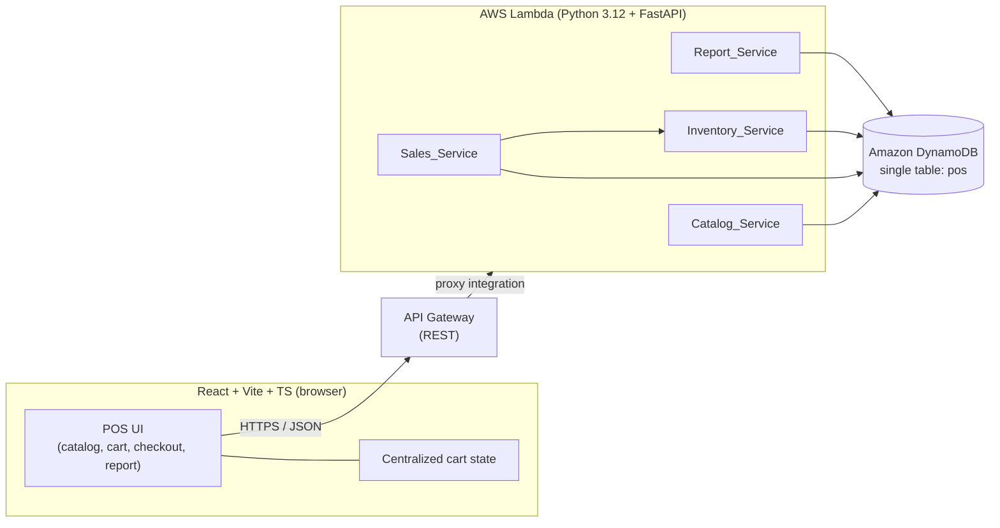
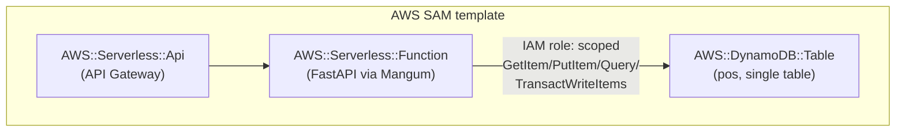

# Design Document

## Overview

This document describes the technical design for the POS MVP defined in `requirements.md`.
The system is a point-of-sale application for small neighborhood shops and cafés, operated
by non-technical staff. The design prioritizes simplicity and correctness over completeness,
in line with the project principles.

The MVP covers four core capabilities, each mapped to a backend component from the glossary:

| Capability | Component | Requirement |
|------------|-----------|-------------|
| Product catalog management | `Catalog_Service` | Requirement 1 |
| Sale registration | `Sales_Service` | Requirement 2 |
| Atomic stock discount | `Inventory_Service` (coordinated by `Sales_Service`) | Requirement 3 |
| Daily sales report | `Report_Service` | Requirement 4 |

The most delicate part of the design is the **atomic stock discount** (Requirement 3): a sale
and the stock reduction of all its items must commit together or not at all, even under
concurrency. This is solved with a single DynamoDB `TransactWriteItems` call guarded by
condition expressions, described in detail in the Architecture and Data Models sections.

### Technology Stack

Per the project steering, the stack is fixed:

- **Frontend**: React + Vite + TypeScript. UI aimed at cashiers with no technical training:
  large buttons, clear Spanish labels, confirmation before irreversible actions, and a
  centralized cart state.
- **Backend**: Python 3.12 + FastAPI.
- **Data**: Amazon DynamoDB, single-table design.
- **Deployment**: AWS serverless — AWS Lambda + API Gateway, with AWS SAM as infrastructure
  as code (architect's decision).
- **Conventions**: code and comments in English; product/user communication in Spanish;
  automated tests for business logic (sales, inventory); no secrets in code or repo.

## Architecture

### High-Level Architecture



Request flow: the React client calls the REST API over HTTPS. API Gateway proxies every
request to a single Lambda running the FastAPI application (via an ASGI adapter such as
Mangum). FastAPI routes the request to the relevant service, which reads/writes the single
DynamoDB table. `Sales_Service` orchestrates `Inventory_Service` for the atomic stock
discount described in Requirement 3.

### Deployment Topology (AWS SAM)



Design decisions and rationale:

- **Single Lambda + FastAPI monolith** rather than one Lambda per service. The four services
  are small and share the same table and models; a single deployable keeps the MVP simple
  (project principle: *simple before complete*) and avoids cross-Lambda coordination for the
  atomic transaction. The four services remain distinct modules in code for maintainability.
- **Single DynamoDB table** (`pos`) as mandated by steering. Catalog items and sales live in
  the same table, partitioned by key design (see Data Models). This enables the atomic
  stock-discount transaction to touch product items and the new sale item in one
  `TransactWriteItems` call.
- **Mangum ASGI adapter** lets the same FastAPI app run locally (uvicorn) for tests and on
  Lambda in production, so business logic is tested without AWS.
- **Scoped IAM role**: the function is granted only the DynamoDB actions it needs on the
  single table. No secrets are embedded in code; configuration (table name, region) comes
  from environment variables injected by SAM.

### Concurrency and Atomicity Strategy

Requirement 3 drives the core of the architecture. The strategy:

1. A sale is validated in memory (items present, quantities valid, payment method valid).
2. Product prices and current existence are read.
3. A single `TransactWriteItems` call is issued containing:
   - One `Update` action per distinct product, decrementing `stock` by the ordered quantity,
     guarded by a condition `stock >= qty`.
   - One `Put` action creating the sale item, guarded by a condition that the sale id does not
     already exist.
4. DynamoDB applies the whole transaction atomically. If any condition fails (insufficient
   stock for any product), the entire transaction is rejected and **no** item is modified.
5. On rejection, `Sales_Service` inspects the cancellation reasons to report exactly which
   products had insufficient stock.

Because DynamoDB `TransactWriteItems` is all-or-nothing and condition expressions are
evaluated atomically at commit time, concurrent sales competing for the same product's stock
are serialized by DynamoDB: at most the set of sales whose combined quantity fits within the
prior available stock commit; the rest fail their condition and are rejected. This satisfies
Requirement 3.1–3.7 without any application-level locking.

## Components and Interfaces

All endpoints are served by the FastAPI app behind API Gateway. Request and response bodies
are JSON. Monetary values are represented as decimal strings (or JSON numbers serialized from
`Decimal`) to avoid binary floating-point rounding errors; the backend uses Python `Decimal`
internally and DynamoDB `Number` for storage.

### Catalog_Service (Requirement 1)

Responsibility: manage catalog products (create, list, update). Owns product validation
(name, price, SKU, stock ranges).

| Method | Path | Purpose | Requirement |
|--------|------|---------|-------------|
| `POST` | `/products` | Create a product | 1.1–1.4 |
| `GET`  | `/products` | List all products | 1.5, 1.6 |
| `PUT`  | `/products/{sku}` | Update name/price/stock of an existing product | 1.7–1.9 |

Create request (`POST /products`):

```json
{ "sku": "CAFE-01", "name": "Café americano", "price": "2.50", "stock": 100 }
```

Success response `201 Created` echoes the stored representation:

```json
{ "sku": "CAFE-01", "name": "Café americano", "price": "2.50", "stock": 100 }
```

Validation rules enforced by the service:

- `name`: string length 1–100.
- `price`: decimal in `[0.01, 999999999.99]`.
- `sku`: string length 1–50.
- `stock`: integer in `[0, 999999]`.
- Create with existing SKU is rejected (duplicate); the existing product is left unchanged.
- Update targets an existing SKU only; a missing SKU is rejected without creating anything.
- An invalid update is rejected and the previous product values are preserved.

Update request (`PUT /products/{sku}`) accepts any subset of `name`, `price`, `stock`.

### Sales_Service (Requirement 2, orchestrates Requirement 3)

Responsibility: register sales, compute totals, validate items/quantities/payment method, and
coordinate the atomic stock discount with `Inventory_Service`.

| Method | Path | Purpose | Requirement |
|--------|------|---------|-------------|
| `POST` | `/sales` | Register a sale (items, payment method) | 2.1–2.8, 3.1–3.7 |

Register request (`POST /sales`):

```json
{
  "items": [
    { "sku": "CAFE-01", "qty": 2 },
    { "sku": "PAN-03", "qty": 1 }
  ],
  "payment_method": "efectivo"
}
```

Success response `201 Created`:

```json
{
  "sale_id": "018f...-uuid",
  "total": "7.50",
  "payment_method": "efectivo",
  "timestamp": "2025-06-01T14:22:05Z",
  "items": [
    { "sku": "CAFE-01", "qty": 2, "unit_price": "2.50", "subtotal": "5.00" },
    { "sku": "PAN-03", "qty": 1, "unit_price": "2.50", "subtotal": "2.50" }
  ]
}
```

Rules:

- Items count 1–100; each quantity integer 1–9999.
- Total = sum of subtotals; subtotal = `unit_price * qty` rounded to 2 decimals; total in
  `[0.01, 999999999.99]`.
- Payment method ∈ {`efectivo`, `tarjeta`}.
- Timestamp recorded at registration time (UTC ISO-8601).
- A non-existent SKU, empty items list, invalid quantity, or invalid payment method rejects the
  sale and persists nothing.
- Insufficient stock rejects the whole sale, persists nothing, and reports each offending SKU.

### Inventory_Service (Requirement 3)

Responsibility: own the stock mutation logic. It builds the `TransactWriteItems` payload
(stock decrements guarded by `stock >= qty`) and interprets transaction cancellation reasons.
It does not expose its own public HTTP endpoint in the MVP; it is invoked in-process by
`Sales_Service`. Stock is also updated through `Catalog_Service` updates (Requirement 1.7).

Internal interface (Python):

```python
class InsufficientStock(Exception):
    skus: list[str]  # products whose available stock < requested qty

def build_sale_transaction(sale: Sale, products: dict[str, Product]) -> list[dict]:
    """Return TransactWriteItems actions: one stock-decrement Update per product
    (condition stock >= qty) plus one Put for the sale item."""

def commit_sale(sale: Sale, products: dict[str, Product]) -> None:
    """Execute the transaction. Raise InsufficientStock listing offending SKUs if any
    stock condition fails; raise TransactionFailed on other transactional failures."""
```

### Report_Service (Requirement 4)

Responsibility: generate the daily sales report for a calendar date.

| Method | Path | Purpose | Requirement |
|--------|------|---------|-------------|
| `GET` | `/reports/daily?date=YYYY-MM-DD` | Daily report; `date` optional (defaults to system today) | 4.1–4.5 |

Success response `200 OK`:

```json
{
  "date": "2025-06-01",
  "sales_count": 12,
  "total": "148.90",
  "by_payment_method": { "efectivo": "96.40", "tarjeta": "52.50" }
}
```

Rules:

- `sales_count` ≥ 0; `total` in `[0.00, 999999999.99]`.
- `by_payment_method` contains only methods with at least one sale that date.
- No sales that date → `sales_count = 0`, `total = "0.00"`, `by_payment_method = {}`.
- Missing `date` → use system current date.
- Invalid-format date or future date → reject; sales data unchanged; error message.

## Data Models

### Single-Table Design

A single DynamoDB table named `pos` stores both products and sales, distinguished by key
design. Partition key `PK` and sort key `SK` are strings.

| Entity | PK | SK | Other attributes |
|--------|----|----|------------------|
| Product | `PRODUCT#<sku>` | `PRODUCT#<sku>` | `name`, `price` (N), `stock` (N), `entity="PRODUCT"` |
| Sale | `SALE#<date>` | `SALE#<ts>#<saleId>` | `total` (N), `payment_method`, `timestamp`, `items` (L), `entity="SALE"` |

Notes:

- `<date>` is the calendar date `YYYY-MM-DD` (UTC) of the sale; `<ts>` is the full ISO-8601
  timestamp; `<saleId>` is a UUID. Putting all sales of one day under the same partition
  (`SALE#<date>`) makes the daily report a single `Query` on that partition.
- A product is a single item whose PK equals its SK, giving an O(1) `GetItem` by SKU and
  letting the sale transaction target the exact product item with a condition on `stock`.
- `items` on a sale stores the line items as a list of maps `{sku, qty, unit_price, subtotal}`
  so the sale is self-describing for the receipt and report without extra lookups.

```mermaid
erDiagram
    PRODUCT {
        string PK "PRODUCT#<sku>"
        string SK "PRODUCT#<sku>"
        string name
        number price
        number stock
    }
    SALE {
        string PK "SALE#<date>"
        string SK "SALE#<ts>#<saleId>"
        number total
        string payment_method
        string timestamp
        list items
    }
```

### Access Patterns

| # | Access pattern | Operation | Keys | Requirement |
|---|----------------|-----------|------|-------------|
| 1 | Get product by SKU | `GetItem` | PK=SK=`PRODUCT#<sku>` | 1.1, 1.7, 2.1 |
| 2 | Create product (reject duplicate) | `PutItem` with `attribute_not_exists(PK)` | `PRODUCT#<sku>` | 1.1, 1.2 |
| 3 | List all products | `Query`/`Scan` filtered by `entity="PRODUCT"` | — | 1.5, 1.6 |
| 4 | Update product | `UpdateItem` with `attribute_exists(PK)` | `PRODUCT#<sku>` | 1.7, 1.8, 1.9 |
| 5 | Register sale + discount stock | `TransactWriteItems` | multiple | 2.1, 3.1–3.7 |
| 6 | Daily report | `Query` on PK=`SALE#<date>` | `SALE#<date>` | 4.1–4.4 |

For the MVP, listing products (pattern 3) uses a `Scan` with a filter expression on
`entity="PRODUCT"`; catalog size for a neighborhood shop is small, so this is acceptable.
If the catalog grows, a GSI keyed on `entity` can be added without changing the item layout.

### Atomic Stock Discount Transaction (Requirement 3)

The sale registration issues one `TransactWriteItems` request. For a sale with items
`{sku_i: qty_i}` and a new `saleId`:

```text
TransactWriteItems([
  # one per distinct product
  Update(
    Key = {PK: "PRODUCT#<sku_i>", SK: "PRODUCT#<sku_i>"},
    UpdateExpression    = "SET stock = stock - :qty_i",
    ConditionExpression = "attribute_exists(PK) AND stock >= :qty_i",
    ExpressionValues    = {":qty_i": qty_i}
  ),
  ...
  # the sale itself
  Put(
    Item = {PK: "SALE#<date>", SK: "SALE#<ts>#<saleId>", total, payment_method,
            timestamp, items, entity: "SALE"},
    ConditionExpression = "attribute_not_exists(SK)"
  )
])
```

How this satisfies Requirement 3:

- **3.1 Sufficient stock → decrement**: each `Update` subtracts `qty_i`; the condition
  `stock >= qty_i` guarantees the result stays `>= 0`.
- **3.2 Atomicity (Descuento_Atomico)**: `TransactWriteItems` commits the sale `Put` and all
  stock `Update`s together or not at all — a native all-or-nothing transaction.
- **3.3 Insufficient stock → reject whole sale, persist nothing**: if any product's condition
  `stock >= qty_i` is false, DynamoDB cancels the entire transaction; nothing is written.
  `Sales_Service` reads `CancellationReasons` to list every SKU whose `ConditionalCheckFailed`
  fired and returns them in the error.
- **3.4 Stock preserved on insufficient-stock rejection**: because nothing commits, all product
  stocks remain exactly at their pre-attempt values.
- **3.5 Commit failure → revert**: any transactional failure (conflict, throttling, condition)
  leaves no partial writes; `Sales_Service` surfaces an error that the sale was not completed.
- **3.6 / 3.7 Concurrency**: concurrent transactions touching the same product are serialized
  by DynamoDB's optimistic concurrency on the item. Only the set of sales whose combined
  quantities fit the prior stock can satisfy their conditions; the rest fail the condition and
  are rejected with insufficient-stock errors, modifying nothing. No application lock needed.

## Correctness Properties

*A property is a characteristic or behavior that should hold true across all valid executions of a system — essentially, a formal statement about what the system should do. Properties serve as the bridge between human-readable specifications and machine-verifiable correctness guarantees.*

These properties target the pure business logic (validation, total calculation, inventory
invariants, report aggregation). They are tested against in-memory/transactional fakes of the
DynamoDB repository so the logic is verified independently of AWS. Each property is a single
property-based test configured for at least 100 iterations.

### Property 1: Create round-trip preserves fields

*For any* valid product (name length 1–100, price in `[0.01, 999999999.99]`, SKU length 1–50,
stock in `[0, 999999]`) created in an empty-or-arbitrary catalog without SKU collision, the
returned stored representation has exactly the same `name`, `price`, `sku`, and `stock` as the
input.

**Validates: Requirements 1.1**

### Property 2: Invalid create is rejected and persists nothing

*For any* product-create request that is invalid — a SKU already present in the catalog, a
price outside `[0.01, 999999999.99]`, a stock outside `[0, 999999]`, an empty or >100-character
name, or an empty or >50-character SKU — the create is rejected with an error naming the
offending condition, and the catalog is left exactly as it was before the request (no item
added, no existing item modified).

**Validates: Requirements 1.2, 1.3, 1.4**

### Property 3: List returns exactly the created products

*For any* set of products with distinct SKUs created into the catalog, listing returns exactly
that set (matched by SKU), each with its stored `name`, `price`, and `stock`.

**Validates: Requirements 1.5**

### Property 4: Update preserves untouched fields; invalid or missing update is rejected and preserves state

*For any* existing product and any valid update applied to a subset of `{name, price, stock}`,
the stored representation reflects the updated fields and leaves the other fields unchanged.
*For any* update targeting a SKU absent from the catalog, or any update with a price or stock
out of range, the update is rejected and the catalog is left exactly as it was before the
request (no product created, existing values preserved).

**Validates: Requirements 1.7, 1.8, 1.9**

### Property 5: Sale total equals the sum of rounded subtotals

*For any* set of sale items (each referencing a priced product and an integer quantity in
`[1, 9999]`), the computed sale total equals the sum over items of `round(unit_price * qty, 2)`,
and the result lies in `[0.01, 999999999.99]`.

**Validates: Requirements 2.2**

### Property 6: Registered sale round-trips its fields with a unique id

*For any* valid sale (1–100 items against existing SKUs with sufficient stock and a payment
method in `{efectivo, tarjeta}`), registration returns a sale id that is unique across all
registered sales, persists the sale, and the persisted sale carries the same items, the
computed total, and the submitted payment method.

**Validates: Requirements 2.1, 2.3**

### Property 7: Invalid sale is rejected and persists nothing

*For any* sale that references at least one SKU absent from the catalog, or contains an item
quantity outside `[1, 9999]`, or carries a payment method not in `{efectivo, tarjeta}`, the
sale is rejected with a validation error (reporting the offending SKU when applicable) and no
sale record is persisted.

**Validates: Requirements 2.5, 2.7, 2.8**

### Property 8: Sufficient stock decrements each product by its quantity

*For any* catalog and any sale whose every item has available stock greater than or equal to
its requested quantity, after registration each affected product's stock equals its prior stock
minus the ordered quantity, and the resulting stock is an integer greater than or equal to 0.

**Validates: Requirements 3.1**

### Property 9: Sale registration is all-or-nothing

*For any* sale request, the resulting state is exactly one of: (a) the sale is persisted **and**
every item's product stock is decremented by its quantity, or (b) no sale is persisted **and**
every product's stock equals its pre-attempt value. No intermediate state (sale without full
discount, or partial discount) ever occurs.

**Validates: Requirements 3.2, 3.4, 3.7**

### Property 10: Insufficient stock rejects the whole sale and reports offending SKUs

*For any* sale where at least one product has available stock strictly less than its requested
quantity, the sale is rejected, no sale record is persisted, and the error reports exactly the
set of SKUs whose available stock is less than the requested quantity.

**Validates: Requirements 3.3**

### Property 11: Concurrent sales never oversell a product

*For any* product and any set of sales competing for that product's stock applied as serialized
conditional transactions, the sum of the ordered quantities across the sales that commit is less
than or equal to the product's prior available stock, and every rejected sale is rejected for
insufficient stock while modifying no stock.

**Validates: Requirements 3.6, 3.7**

### Property 12: Daily report aggregates count and total for its date

*For any* set of registered sales spread across calendar dates, the daily report for a given
date returns a `sales_count` equal to the number of sales registered on that date and a `total`
equal to the sum of those sales' totals, with the total in `[0.00, 999999999.99]`.

**Validates: Requirements 4.1**

### Property 13: Daily report breakdown partitions the total by payment method

*For any* set of sales on a date, the report's `by_payment_method` contains a key for exactly
those payment methods used by at least one sale on that date, each mapped to the sum of totals
of that date's sales with that method, and the sum of all breakdown values equals the report's
overall `total`.

**Validates: Requirements 4.2**

### Property 14: Invalid or future report dates are rejected and leave data unchanged

*For any* report request whose date has an invalid calendar format or is in the future relative
to the system's current date, the request is rejected with an invalid-date error and the stored
sales data is left exactly unchanged.

**Validates: Requirements 4.5**

## Error Handling

The backend maps each failure class to a consistent HTTP status and a JSON error envelope.
Error messages shown to end users are rendered in Spanish by the React client; the API returns a
machine-readable `code` plus a human-readable `message`.

Error response envelope:

```json
{ "error": { "code": "DUPLICATE_SKU", "message": "El SKU ya existe en el catálogo.", "details": { "sku": "CAFE-01" } } }
```

| Scenario | HTTP status | `code` | Requirement |
|----------|-------------|--------|-------------|
| Field validation failure (name/price/sku/stock/qty/payment method range or format) | `400 Bad Request` | `VALIDATION_ERROR` | 1.3, 1.4, 1.9, 2.6, 2.7, 2.8, 4.5 |
| Create with existing SKU | `409 Conflict` | `DUPLICATE_SKU` | 1.2 |
| Update or sale references a SKU not in catalog | `404 Not Found` | `PRODUCT_NOT_FOUND` / `UNKNOWN_SKU` | 1.8, 2.5 |
| Sale rejected for insufficient stock | `409 Conflict` | `INSUFFICIENT_STOCK` (with `skus` list) | 3.3 |
| Sale rejected under concurrency (stock condition failed) | `409 Conflict` | `INSUFFICIENT_STOCK` | 3.6, 3.7 |
| Transaction failed for non-stock reasons (throttling, transient) | `503 Service Unavailable` | `TRANSACTION_FAILED` | 3.5 |
| Report requested with invalid-format or future date | `400 Bad Request` | `INVALID_DATE` | 4.5 |
| Unexpected server error | `500 Internal Server Error` | `INTERNAL_ERROR` | — |

Handling rules:

- Validation runs before any DynamoDB write, so invalid requests never touch storage
  (satisfying the "persist nothing" clauses of Requirements 2 and 3).
- Insufficient-stock detection comes from inspecting `TransactWriteItems`
  `CancellationReasons`: each `ConditionalCheckFailed` on a `PRODUCT#<sku>` update maps to an
  offending SKU in the `INSUFFICIENT_STOCK` error details (Requirement 3.3).
- `TransactionCanceledException` for reasons other than a stock condition (e.g.,
  `TransactionConflict`, throttling) maps to `TRANSACTION_FAILED`; because the transaction never
  commits, stock and sales remain unchanged (Requirement 3.5).
- Monetary and quantity bounds are validated with explicit range checks using `Decimal`, never
  binary floats, to avoid rounding surprises at the boundaries.
- The React client confirms irreversible actions (registering a sale) before calling the API and
  surfaces the returned `code`/`message` with a clear Spanish explanation and the offending SKUs
  when present.

## Testing Strategy

A dual approach is used: property-based tests verify the universal correctness properties above
across many generated inputs, and example/integration tests cover specific scenarios, edge
cases, and the AWS integration boundary.

### Property-Based Tests

- **Library**: [Hypothesis](https://hypothesis.readthedocs.io/) for Python 3.12.
- **Scope**: the pure business logic — product validation, sale total calculation, inventory
  decrement/atomicity invariants, and report aggregation — exercised against an in-memory
  transactional fake of the DynamoDB repository. The fake implements `TransactWriteItems`
  semantics (all-or-nothing with per-item condition checks) so Properties 8–11 can be verified
  without AWS.
- **Configuration**: each property test runs a minimum of 100 iterations
  (`@settings(max_examples=100)` or higher). Generators (`@st.composite`) produce valid and
  invalid products, sales, quantities, prices, payment methods, dates (including boundary,
  out-of-range, invalid-format, and future values), and multi-sale concurrency sequences.
- **Traceability**: each property test is tagged with a comment referencing its design property:
  `# Feature: pos-mvp, Property {number}: {property_text}`.
- **Mapping** (one property-based test per property):

  | Test | Property | Requirements |
  |------|----------|--------------|
  | create round-trip | Property 1 | 1.1 |
  | invalid create rejected | Property 2 | 1.2, 1.3, 1.4 |
  | list returns created set | Property 3 | 1.5 |
  | update preserves/rejects | Property 4 | 1.7, 1.8, 1.9 |
  | total correctness | Property 5 | 2.2 |
  | sale round-trip + unique id | Property 6 | 2.1, 2.3 |
  | invalid sale rejected | Property 7 | 2.5, 2.7, 2.8 |
  | stock decrement | Property 8 | 3.1 |
  | all-or-nothing | Property 9 | 3.2, 3.4, 3.7 |
  | insufficient-stock reporting | Property 10 | 3.3 |
  | concurrency no-oversell | Property 11 | 3.6, 3.7 |
  | report count+total | Property 12 | 4.1 |
  | report breakdown | Property 13 | 4.2 |
  | invalid/future date rejected | Property 14 | 4.5 |

### Example-Based Unit Tests

Cover specific scenarios and edge cases that do not vary meaningfully with input:

- Empty catalog list returns `[]` (Requirement 1.6).
- Empty items list on a sale is rejected (Requirement 2.6).
- Timestamp is recorded at registration within a reasonable window around "now"
  (Requirement 2.4).
- Non-stock transaction failure (injected into the fake) reverts cleanly and returns
  `TRANSACTION_FAILED` with stock preserved (Requirement 3.5).
- Report for a date with no sales returns `count 0`, `total 0.00`, empty breakdown
  (Requirement 4.3).
- Report with omitted date uses the system current date (Requirement 4.4).

### Integration Tests

A small set of integration tests (1–3 examples each) runs against **DynamoDB Local** to verify
the AWS boundary that the fakes cannot cover:

- Real `TransactWriteItems` commits a sale and decrements stock atomically.
- A real condition failure (`stock >= qty`) cancels the whole transaction and reports the SKU.
- Two concurrent sale transactions competing for the same product: at most the set that fits the
  prior stock commits; the rest are rejected (validates the real serialization behind
  Requirement 3.6).

These complement — but do not replace — the property-based tests, which own the universal-logic
coverage.
